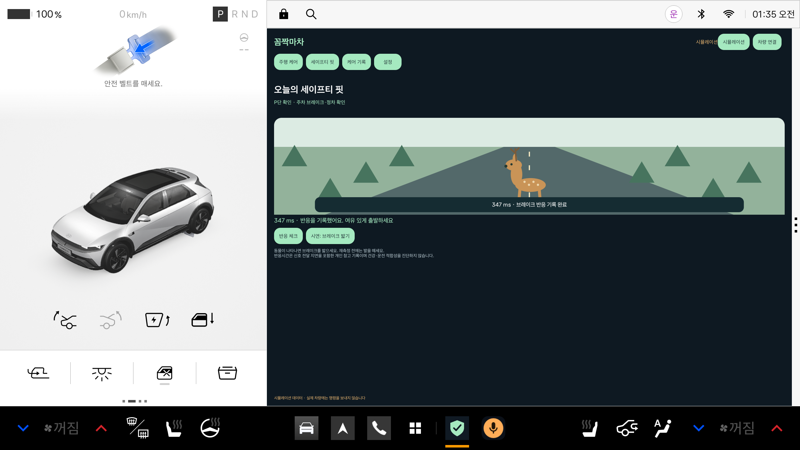

# 꼼짝마차

팀명: **연근** · 앱명: **꼼짝마차**

출발 전 브레이크 반응시간을 기록하고, 야간·우천·터널 등 주행 환경에 따라 차량 설정을 조절하는 Pleos Connect 앱.

## APK 다운로드

[꼼짝마차 3.1.0 Release APK 다운로드](https://github.com/Controllls/stopcar/raw/refs/heads/main/apk/stopcar-3.1.0-release.apk) · [파일 및 검증 정보](apk/release-info.json)

크기 **26.95MB** · 릴리즈 서명 검증 완료 · `debuggable=false` · Pleos 에뮬레이터 기기 테스트 **6개 통과**.

```powershell
adb install -r apk/stopcar-3.1.0-release.apk
adb shell am start --user current -n com.example.careway/.MainActivity
```

릴리즈 전용 키로 서명한 APK다. 기존 Debug 앱과 서명이 달라 덮어쓸 수 없다. Debug 앱이 설치된 기기는 기록을 내보낸 뒤 기존 앱을 제거하고 설치한다.

## 주요 기능

| 기능 | 동작 |
|---|---|
| 세이프티 핏 | 동물이 화면에 표시된 시점부터 브레이크 이벤트 수신까지 반응시간 측정. 조기 입력·시간 초과·측정 취소 처리, 최근 개인 기록 비교 |
| 출발 전 안내 | 차량 연결 후 정차 조건이 확인되면 반응 체크 안내 |
| 야간 케어 | 야간 상태·차속·하향등을 확인해 미점등 경고, 음성 안내, 실내 조명 감광 요청 |
| 우천 케어 | 와이퍼 상태에 따라 제상·외기·양쪽 미러 열선·실내 조명 제어 요청. 마지막 우천 신호 이후 10초 유지 |
| 터널 케어 | TBT 터널 정보 기준 200m 이내 접근 안내와 내기 순환 요청. 우천 시 시야 확보 우선 |
| 출구·역광 시연 | 출구 100m 이내 또는 역광 시나리오에서 스마트글라스 감광, 최대 15초 후 복원 |
| 설정 복원 | 변경 전 값을 저장하고 제어 후 실제 값 재조회. 케어 중지·화면 이탈·재연결 시 복원, 수동 변경 우선 |
| 음성 안내 | Pleos 온디바이스 한국어 음성 합성 |
| 케어 기록 | 최근 30일 반응시간·전조등 안내 집계, JSON·CSV 저장, 공유 앱 연동 |

반응 체크는 완전 정차·P단·주차 브레이크·UX 조작 허용·브레이크 이벤트 수신 조건에서 시작한다. 측정값에는 차량 신호 전달 지연이 포함된다. 실제 차량 기록과 시뮬레이션 기록은 분리해 저장한다.

## 화면

### 주행 케어 · 시뮬레이션


### 세이프티 핏 · 시뮬레이션



## 기술 구성

| 구분 | 사용 기술 |
|---|---|
| 언어 | Kotlin |
| 화면 | Android Activity·View·Canvas |
| 상태 관리 | CareController·StateCell, Handler로 화면 갱신 |
| 비동기 처리 | Executor·SDK 콜백·CompletableFuture |
| 차량 상태·제어 | Pleos Vehicle 2.3.2 |
| 내비게이션 | Pleos NaviHelper 3.0.5 |
| 음성 | Pleos TextToSpeech 3.3.1, ON_DEVICE·ko-KR |
| 표준 차량 정보 | AAOS CarPropertyManager·CarUxRestrictionsManager |
| 저장 | SharedPreferences·JSON |
| 테스트 | JUnit 4·Android Instrumentation |

앱 코드에는 AndroidX·Compose·Coroutines를 직접 사용하지 않는다. Pleos SDK의 전이 의존성에 포함된 AndroidX·Coroutines는 유지한다.

차량 입력 → 상황 판단 → 안내·제어 요청 → 실제 값 확인 → 기록·복원 순서로 처리한다. 차량 통신은 작업 스레드에서 실행하고, 반응 측정과 화면 갱신은 메인 스레드에서 처리한다.

## 빌드 및 실행

- Android SDK 37, minSdk 28
- Gradle 9.6.0, AGP 9.4.1
- Pleos Connect 에뮬레이터 및 SDK 서비스
- 실행 모듈: `careway`
- 앱 ID: `com.example.careway`
- 버전: `3.1.0`

SDK 경로를 `local.properties` 또는 `ANDROID_HOME`에 설정한다. Gradle Wrapper와 JVM 도구 체인 설정은 저장소에 포함되어 있다.

```powershell
.\gradlew.bat :careway:assembleDebug
adb install -r careway\build\outputs\apk\debug\careway-debug.apk
adb shell am start --user current -n com.example.careway/.MainActivity
```

릴리즈 빌드: `.\gradlew.bat :careway:assembleRelease`. 서명 설정은 저장소 외부의 `~/.gradle/stopcar-release.properties` 또는 `-PstopcarSigningFile=경로`로 지정한다. 필드는 `storeFile`, `storePassword`, `keyAlias`, `keyPassword`이며, 설정이 없으면 서명되지 않은 APK가 생성된다.

## 기능 실행

1. **시뮬레이션 → 반응 체크 시작**을 누른다. 1.5~3.5초 뒤 동물이 나타나면 **시연: 브레이크 밟기**를 누른다. 재측정 전에는 **시연: 브레이크 떼기**를 누른다.
2. **야간 미점등**을 선택해 경고를 확인하고 **시연: 전조등 켜기**로 해제한다.
3. **야간 빗길 / 터널 180m 전 / 출구 80m 전 / 직사광선**으로 상황별 케어를 확인한다.
4. **통과 후 복원** 또는 **케어 중지**로 설정 복원을 확인한다.
5. **차량 연결 → 케어 켜기**로 실제 SDK 입력을 사용한다. 시작 시 정차 조건과 권한을 확인한다.
6. **케어 기록**에서 JSON·CSV 저장 및 공유, **설정**에서 기능별 활성화와 음성 테스트를 실행한다.

## 연동 상태

| 항목 | 확인 범위 |
|---|---|
| 속도·기어·주차 브레이크·브레이크 | 에뮬레이터에서 AAOS·Pleos 입력 수신 확인 |
| 내비게이션 | TBT 수신 및 터널 접근 처리 구현. 실제 경로의 터널 주행 시험 미실시 |
| 음성 | 한국어 합성 완료·오디오 출력 로그 확인 |
| 미러 열선 | 3.0.0에서 양쪽 미러 변경·복원 확인 |
| 공조·제상·내외기·실내 조명 | 제어 요청 구현. 3.0.0 에뮬레이터에서 성공 응답 후 값 변경 미확인 |
| 출구·역광·스마트글라스 | 시뮬레이션 검증. 실제 출구·역광 입력 미연동, 에뮬레이터 스마트글라스 미지원 |

차량별 지원 여부는 capability API로 확인한다. 물리 차량 주행 시험은 미실시 상태다.

## 테스트

단위 테스트 **36개**, 기기 테스트 **6개** 통과. Lint 오류 **0개**, 경고 **20개**. [검증 결과 및 APK 해시](docs/validation-3.1.0.json)

```powershell
.\gradlew.bat :careway:testDebugUnitTest :careway:lintDebug :careway:assembleDebug :careway:assembleDebugAndroidTest
adb install -r careway\build\outputs\apk\debug\careway-debug.apk
adb install -r careway\build\outputs\apk\androidTest\debug\careway-debug-androidTest.apk
adb shell am instrument --user current -w com.example.careway.test/com.example.careway.NativeTestRunner
```

기기 테스트는 반응 측정·조기 입력·화면 이탈 취소·설정 복원 시뮬레이션·기록 이전·내보내기·Activity 재생성·SDK 읽기·모드 전환을 검사한다. SDK 전이 의존성 JNA의 16KB 페이지 정렬 경고가 남아 있다.

## 디렉터리 구조

```text
careway/src/main/java/com/example/careway/
  MainActivity.kt       권한·생명주기·문서 저장 연동
  CareController.kt     상태 관리·케어·반응 측정 흐름
  core/                 상태 객체·상황 판단·제어 및 복원 정책
  vehicle/              Pleos·AAOS 연결·음성·시뮬레이션
  data/                 기록 저장·집계·내보내기
  ui/                   주행·반응 체크·기록·설정 화면
careway/src/test/        단위 테스트
careway/src/androidTest/ 기기 테스트
```
