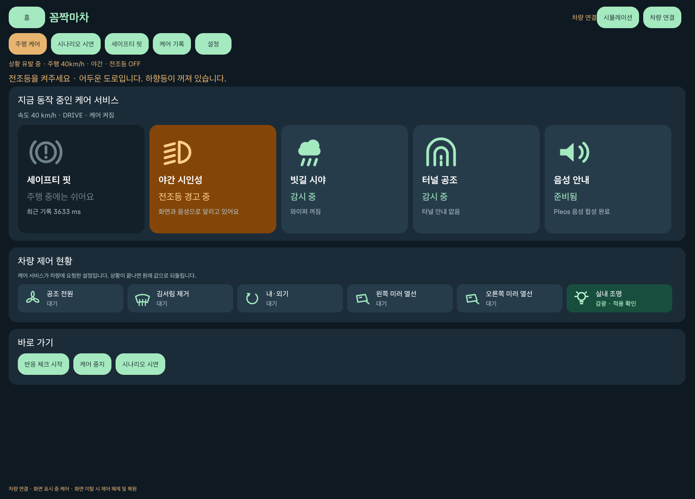

# 꼼짝마차

팀명: **연근** · 앱명: **꼼짝마차**

출발 전 브레이크 반응으로 오늘의 컨디션을 확인하고, 야간·우천·터널 등 주행 환경에 따라 차량 설정을 조절하는 Pleos Connect 앱.

## 다운로드

[꼼짝마차 APK 다운로드](https://github.com/Controllls/stopcar/raw/refs/heads/main/apk/연근_꼼짝마차_release.apk)

저장소 내 APK 위치: [`apk/연근_꼼짝마차_release.apk`](apk/연근_꼼짝마차_release.apk)

> 저장소의 APK는 3.1.0 빌드이고, 소스는 3.5.0이다. 아래 설명은 3.5.0 소스 기준이다.

```powershell
adb install -r apk/연근_꼼짝마차_release.apk
adb shell am start --user current -n com.example.careway/.MainActivity
```

## 주요 기능

| 기능 | 동작 |
|---|---|
| 세이프티 핏 | 동물이 화면에 표시된 시점부터 브레이크 이벤트 수신까지 반응시간을 3회 측정하고 평균으로 오늘의 컨디션 표시(0.5초 이하 정상, 1초 미만 주의, 1초 이상 느림). 느림이면 전방 주의 알림 강화, 음성 안내, 정차 중 환기 요청. 조기 입력·시간 초과·측정 취소 처리 |
| 출발 전 안내 | 앱을 열면 차량에 자동 연결하고, 정차 조건이 확인되면 ‘오늘의 반응성 체크’ 안내 |
| 야간 케어 | 야간 상태·차속·하향등을 확인해 미점등 시 화면 전체 주황 경고, 음성 안내, 실내 조명 감광 요청 |
| 우천 케어 | 와이퍼 연속 작동 상태에 따라 제상·외기·양쪽 미러 열선·실내 조명 제어 요청. 마지막 우천 신호 이후 10초 유지 |
| 터널 케어 | 내비 TBT의 터널 입구 거리 기준 100m 이내에서 내기 순환 요청, 입구 통과 후 30초 유지 뒤 복원. 우천 시 시야 확보 우선 |
| 서비스 현황판 | 홈 화면에서 세이프티 핏·야간 시인성·빗길 시야·터널 공조·음성 안내의 동작 상태와 차량 제어 현황을 아이콘으로 표시 |
| 설정 복원 | 변경 전 값을 저장하고 제어 후 실제 값 재조회. 케어 중지·화면 이탈·재연결 시 복원, 수동 변경 우선 |
| 음성 안내 | Pleos 온디바이스 한국어 음성 합성 |
| 케어 기록 | 최근 30일 반응시간·전조등 안내 집계, JSON·CSV 저장, 공유 앱 연동 |
| 시나리오 시연 | 에뮬레이터에서 만들 수 없는 주행 상황(야간 미점등, 소나기, 터널 접근)을 버튼으로 유발. 유발하는 것은 입력뿐이며 감지·경고·음성·차량 제어·복원은 같은 기능 경로가 실행 |

반응 체크는 완전 정차·P단·UX 조작 허용·브레이크 이벤트 수신 조건에서 시작한다. 측정값에는 차량 신호 전달 지연이 포함된다. 실제 차량 기록과 시뮬레이션 기록은 분리해 저장한다.

## 화면

### 주행 케어 · 서비스 현황판



### 세이프티 핏 · 3회 측정과 컨디션


## 기술 구성

| 구분 | 사용 기술 |
|---|---|
| 언어 | Kotlin |
| 화면 | Android Activity·View·Canvas |
| 상태 관리 | CareController·StateCell, Handler로 화면 갱신 |
| 비동기 처리 | Executor·SDK 콜백·CompletableFuture |
| 차량 상태·제어 | Pleos Vehicle SDK (브레이크·하향등·와이퍼 상태, 공조·미러 열선·실내 조명 제어) |
| 내비게이션 | Pleos NaviHelper SDK (TBT 터널 입구 거리) |
| 음성 | Pleos TextToSpeech SDK, ON_DEVICE·ko-KR |
| 표준 차량 정보 | AAOS CarPropertyManager(차속·기어·야간)·CarUxRestrictionsManager |
| 저장 | SharedPreferences·JSON |

차량 입력 → 상황 판단 → 안내·제어 요청 → 실제 값 확인 → 기록·복원 순서로 처리한다. 차량 통신은 작업 스레드에서 실행하고, 반응 측정과 화면 갱신은 메인 스레드에서 처리한다. 제어 요청은 한 번에 보내고, 차량 값이 바뀐 것을 다시 읽었을 때만 적용 완료로 표시한다.

## 테스트 환경 및 필요한 설정

| 항목 | 설정 |
|---|---|
| 개발·실행 에뮬레이터 | Pleos Connect Emulator **v2.1.0** |
| 시스템 이미지 | Android, x86_64 |
| 화면 규격 | **2560×1440px, 160dpi**, 가로 화면 |
| 실행 사용자 | user 10 |
| 개발 호스트 | Windows, Android Studio |
| 차량 연동 | Pleos 차량·내비게이션·음성 서비스 및 기능별 권한 |

- 반응 측정은 완전 정차·P단·UX 조작 허용·브레이크 이벤트 수신이 필요하다.
- 브레이크 페달·하향등·와이퍼·기어·차속은 에뮬레이터 가상 콘솔로 바꿔 확인할 수 있다. 야간 신호와 터널 안내는 에뮬레이터에서 만들 수 없어 시나리오 시연으로 확인한다.
- 시뮬레이션 모드는 가상 차량으로 실행하며 실제 차량에는 명령을 보내지 않는다.
- 차량 제어 기능은 해당 차량의 API 지원 여부와 권한에 따라 동작한다.

## 빌드 및 실행

- Android SDK, Gradle
- Pleos Connect 에뮬레이터 및 SDK 서비스
- 실행 모듈: `careway`
- 앱 ID: `com.example.careway`

SDK 경로를 `local.properties` 또는 `ANDROID_HOME`에 설정한다. Gradle Wrapper와 JVM 도구 체인 설정은 저장소에 포함되어 있다.

```powershell
.\gradlew.bat :careway:assembleDebug
adb install -r careway\build\outputs\apk\debug\careway-debug.apk
adb shell am start --user current -n com.example.careway/.MainActivity
```

릴리즈 빌드: `.\gradlew.bat :careway:assembleRelease`. 서명 설정은 저장소 외부의 `~/.gradle/stopcar-release.properties` 또는 `-PstopcarSigningFile=경로`로 지정한다. 필드는 `storeFile`, `storePassword`, `keyAlias`, `keyPassword`이며, 설정이 없으면 서명되지 않은 APK가 생성된다.

단위 테스트: `.\gradlew.bat :careway:testDebugUnitTest`

## 사용 방법

1. 앱을 열면 차량에 자동으로 연결하고 케어를 시작한다. 정차 중이면 ‘오늘의 반응성 체크’ 안내가 뜬다.
2. **지금 시작**을 누르고 동물이 나타날 때마다 브레이크를 밟는다. 밟은 뒤 발을 떼면 다음 측정이 시작되고, 3회 평균으로 컨디션이 표시된다.
3. **주행 케어** 홈에서 서비스별 동작 상태와 차량 제어 현황을 확인한다.
4. **시나리오 시연**에서 **야간 도로 진입 · 전조등 OFF / 소나기 시작 / 터널 접근 주행 시작**으로 상황을 유발하고, **상황 종료** 또는 **케어 중지**로 설정 복원을 확인한다.
5. **시뮬레이션**을 누르면 가상 차량으로 같은 기능을 확인할 수 있다. 반응 체크에서는 **시연: 브레이크 밟기/떼기**를 사용한다.
6. **케어 기록**에서 JSON·CSV 저장 및 공유, **설정**에서 기능별 활성화와 음성 테스트를 실행한다.

## 디렉터리 구조

```text
careway/src/main/java/com/example/careway/
  MainActivity.kt       권한·생명주기·문서 저장 연동
  CareController.kt     상태 관리·케어·반응 측정 흐름
  core/                 상태 객체·상황 판단·시나리오 유발·제어 및 복원 정책
  vehicle/              Pleos·AAOS 연결·음성·시뮬레이션
  data/                 기록 저장·집계·내보내기
  ui/                   주행·반응 체크·시나리오·기록·설정 화면, 아이콘
```
